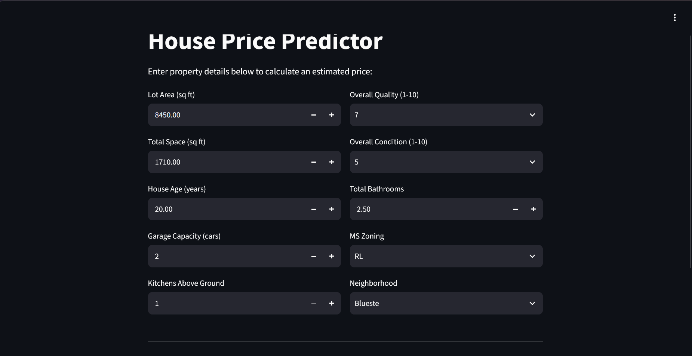
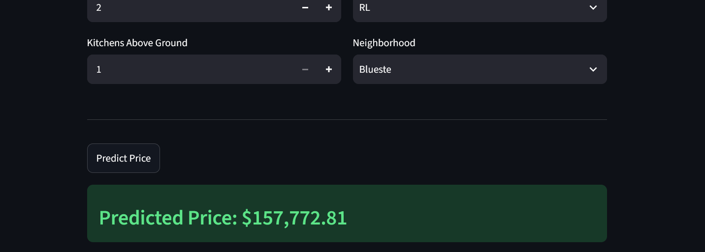

# House Price Predictor

A machine learning web app that predicts a house's sale price from its features. Built with scikit-learn, FastAPI, and Streamlit, packaged with Docker, and deployed on AWS EC2.

**Live demo:** [http://98.80.64.168:8501/](http://98.80.64.168:8501/)




## What it does

Enter details like living space, house age, condition, bathrooms, garage size, zoning, and neighbourhood. The app returns an estimated price instantly.

## Tech stack

- Python, pandas, scikit-learn, numpy, seaborn, matplotlib
- FastAPI (API)
- Streamlit (web app)
- Docker (packaging)
- AWS EC2 (hosting)

## Dataset and model

- **Data:** [Ames Housing dataset](https://www.kaggle.com/c/house-prices-advanced-regression-techniques) from Kaggle
- **Model:** Lasso regression
- **Results:** RMSE $21,592, R² 0.9075 on a held-out test set

## Project structure

```
├── app/             # Backend: FastAPI prediction API
├── frontend/        # Streamlit user interface
├── model/           # Trained model files
├── schema/          # Input data definitions
├── data/            # Dataset
├── Notebook/        # Data exploration and model training
├── start.sh         # Launches the app services inside the container
├── requirements.txt # Python dependencies
├── Dockerfile       # Container setup
├── .dockerignore
├── .gitignore
├── screenshot1.png  # App screenshots
├── screenshot2.png
└── README.md
```

## Run it locally

```bash
git clone https://github.com/Alegbeleye-Ayomide/House-price-prediction.git
cd House-price-prediction
pip install -r requirements.txt

# Start the API
uvicorn app.app:app --reload

# In a second terminal, start the frontend
streamlit run frontend.py
```

Open `http://localhost:8501`.

## Run with Docker

```bash
docker pull mlengayo/housepricepredictionapp
docker run -p 8501:8501 -p 8000:8000 mlengayo/housepricepredictionapp
```

- Frontend: http://localhost:8501
- API: http://localhost:8000 (interactive docs at http://localhost:8000/docs)

## Deployment

The Docker image runs on an **AWS EC2** instance, with port 8501 opened in the security group.

## Limitations

- Trained only on houses in Ames, Iowa (2006-2010), so it is not suitable for other locations or today's market.
- Returns a single estimate with no confidence range.
- A learning project, not valuation advice.

## Author

**Alegbeleye Ayomide**: Computer Engineering student & ML engineer
[GitHub](https://github.com/Alegbeleye-Ayomide) · [LinkedIn](https://www.linkedin.com/in/alegbeleye-ayomide-b74a13394/)
